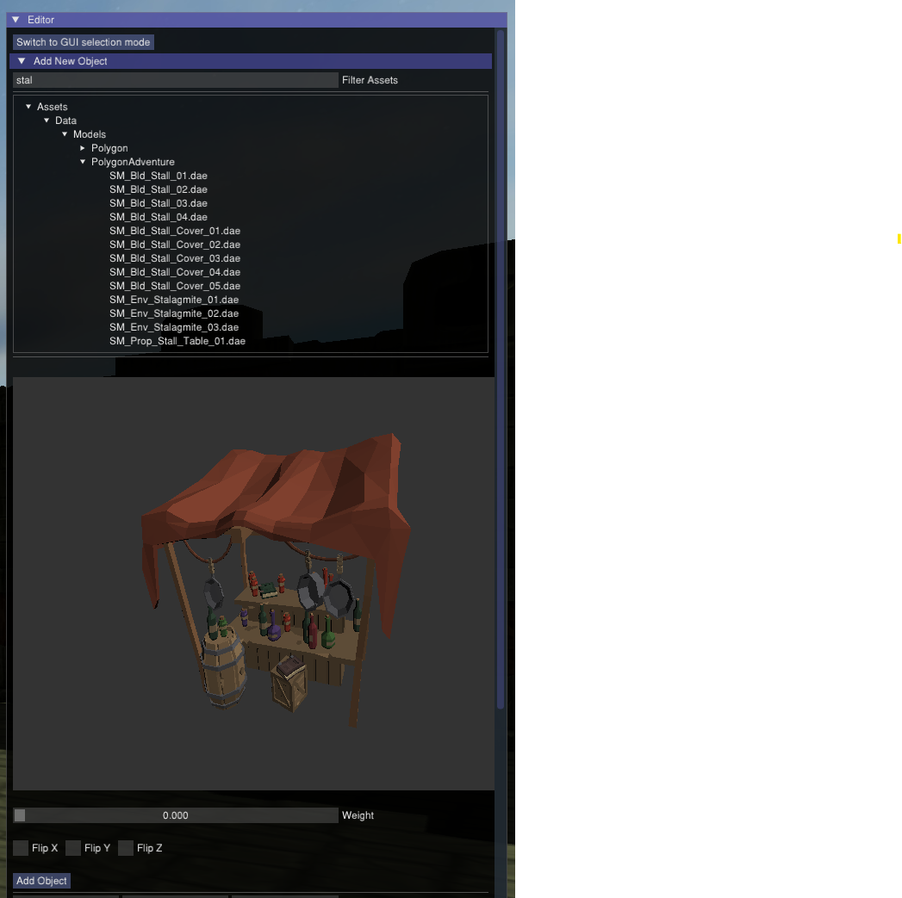

.. _AssetManagement:

================
Asset Management
================

The asset manager handles loading, processing, and lifetime management of all engine assets. It operates at the process level - assets are shared across all worlds, so the same resource is never loaded twice.

Asset Types
===========

.. list-table::
   :header-rows: 1
   :widths: 20 20 60

   * - Type
     - Source library
     - Notes
   * - Models (raw)
     - Assimp
     - 60+ formats supported. Used during development.
   * - Models (limonmodel)
     - Native
     - Engine-native format. Used for release builds. See `limonmodel`_ below.
   * - Animations
     - Assimp
     - Mixamo retargeting supported.
   * - Textures
     - SDL3_image
     - All formats supported by SDL3_image.
   * - Audio
     - OpenAL
     - WAV only.
   * - Materials
     - Model asset or world file
     - Deduplicated automatically regardless of source. Their textures load only while something draws them. See `Materials as Assets`_ below.
   * - Shaders
     - GLSL
     - Discovered at launch via runtime reflection.

Loading Pipeline
================

Asset loading is split into two layers to maximise parallelism while keeping GPU uploads on the main thread:

* **CPU layer** - a thread pool decompresses, parses, and converts assets in parallel. Each completed asset is pushed to a thread-safe queue.
* **GPU layer** - the main thread consumes from the queue and does the GPU uploads.

A world signals ready only after all assets have completed both layers - no partial asset state is visible to the scene. In the editor, a model can only be placed after its loading is fully complete.

.. _AssetManagement-failures:

When Loading Fails
==================

Loading calls don't return an error. Failures are written to standard error, and whether the engine keeps running depends on what failed:

.. note::
    Failing hard is deliberate. Falling back to something that looks plausible turns a missing asset into a problem that shows up somewhere else, much later, and takes far longer to identify and fix than an engine that stops at the file it could not load.

    Textures are the one exception, because it is not the content's fault: many model formats store the texture paths from the machine the asset was made on, which never match the paths on the user's machine. The search by file name recovers those without the artist editing every model.

.. list-table::
   :header-rows: 1
   :widths: 35 65

   * - Failure
     - What happens
   * - Texture file missing or unreadable
     - The engine looks through the known assets under ``./Data`` for a file with the same name, then for the same name with any image extension, and uses the first one that loads. If none does, it logs ``TextureAsset Load from disk failed`` and uses ``./Engine/Textures/notFoundFallback.jpg``. The world keeps loading. If the fallback itself is missing, the engine exits.
   * - Texture referenced by a model
     - Found and resolved the same way, so a model whose textures were moved still loads, with the fallback texture if nothing matches. A texture slot the model file can't describe at all is left empty, with a log message.
   * - Texture of a material nothing draws
     - Not loaded, so nothing is logged for it. The path is still resolved by file name when the model loads, silently. A path that was resolved is logged as ``names texture ..., using ... found by file name`` the first time something draws the material, and a missing one is logged then as above.
   * - Model can't be imported, has no meshes, or has a material without a name
     - The engine exits, after an ``ERROR::ASSIMP`` or similar message.
   * - Sound file can't be read
     - The engine exits.
   * - World file missing or not valid XML
     - The engine exits.
   * - World file with invalid content (a required element missing, invalid IDs)
     - The engine exits, both at startup and when switching worlds during play.

The exits apply to API calls too: ``addObject``, ``playSound`` and ``setMusic`` take a path and don't check it first, so a wrong path stops the engine. Check the paths your extensions use during development.

World changes requested through the API (``loadAndSwitchWorld`` and the related calls) are queued and carried out after the current tick, so the call returns ``true`` as soon as the request is queued. If the load then fails, the engine exits.

Reference Counting
==================

* Objects hold read-only references to managed assets - no object owns an asset outright.
* Reference counting releases assets automatically when no world holds a reference.
* Assets shared between worlds are not reloaded during world transitions and are not double-counted by the reference system.

Materials as Assets
===================

A material embedded in a model file and a material defined in the world file are the same kind of object, and the engine manages them the same way.

If two models have identical materials, they share one. Materials are identical when their colours, values and texture files match; the name doesn't count. Custom materials created or modified in the editor are saved in the world file and loaded identically to model-sourced materials.

A material uses GPU resources only while something draws it: its textures, and a slot in the material buffer, whose size is set by the ``NR_MAX_MATERIALS`` constant. The current configuration is 200, but you can change it to suit your target hardware. A model's materials are known as soon as the model loads, but one that every object in the world replaces with another material never loads its textures and takes no slot. When the last object drawing a material is removed or switched to another material, its textures are freed and its slot is reused. So the limit counts the materials that are drawn, not every material of every loaded model.

A packed game follows the same rule: the packer includes the textures of a model's own materials only if some placed object, in some packed world, draws them. A model that is named rather than placed, by a type's declared files (see :ref:`API-pack-file-access-list`) or by a parameter in a world, can be spawned anywhere, so all its materials' textures are packed. The converted ``.limonmodel`` still holds every material of the source model, so nothing is lost if a later world uses one.

For how to create and edit materials in the editor, see :ref:`UsingBuiltinEditor`.

World Transitions
=================

Four API methods control how the asset manager handles memory when switching worlds. The choice trades memory footprint against load time:

.. list-table::
   :header-rows: 1
   :widths: 24 12 13 51

   * - Method
     - Memory
     - Load time
     - Description
   * - ``loadAndSwitchWorld``
     - Higher
     - Shorter
     - New world loads while old stays in memory. Assets shared between both worlds are not reloaded. (:ref:`C++ <LimonAPI-loadAndSwitchWorld>` | :ref:`Python <pythonApi-load_and_switch_world>`)
   * - ``returnToWorld``
     - Higher
     - Shorter
     - Returns to a previously loaded world still in memory. (:ref:`C++ <LimonAPI-returnToWorld>` | :ref:`Python <pythonApi-return_to_world>`)
   * - ``loadAndRemove``
     - Lower
     - Longer
     - Releases old world and its exclusive assets before loading the new world. (:ref:`C++ <LimonAPI-loadAndRemove>` | :ref:`Python <pythonApi-load_and_remove>`)
   * - ``returnPreviousWorld``
     - Lower
     - Longer
     - Returns to the previous world after releasing the current one. (:ref:`C++ <LimonAPI-returnPreviousWorld>` | :ref:`Python <pythonApi-return_previous_world>`)

:ref:`quitGame <LimonAPI-quitGame>` / :ref:`quit_game <pythonApi-quit_game>` exits the application.

.. _limonmodel:

limonmodel - Engine-Native Format
==================================

Raw model formats (FBX, OBJ, GLTF, etc.) are suitable for development but carry redistribution restrictions and parse overhead. The ``limonmodel`` format is optimised for release:

* Near memory-direct layout - loading is read-and-map rather than parse-and-transform.
* Contains: vertex and index buffers, skeletal animation data, material information, and textures if they were embedded in the source file.
* Also contains everything that would otherwise be computed at load: the generated :ref:`LOD levels <LevelOfDetail>` together with what was asked of each one (distance and pixel limits) and what it measured, any per-model LOD settings, and a baked software occluder for every LOD level. A converted model neither simplifies nor bakes at load, and never reads or writes a ``.limon`` sidecar.
* Texture handling mirrors the source - embedded textures stay embedded; external texture references stay external.
* Faster load times and smaller file size than raw formats.
* Works around raw asset redistribution restrictions.

To convert all models in a world, use the **Convert models to binary** button in the world editor. The world file is updated to reference the converted assets automatically.

Conversion bakes the occluders for all LOD levels first, which makes it slower than a plain save but lets :ref:`occlusion_bakeLodLevel <option-occlusion_bakeLodLevel>` be changed afterwards without re-exporting.

Flipped models
--------------

A model referenced with flipped axes has its mirroring applied to the vertices themselves, so each flip is different geometry and gets its own file: ``Saloon.obj`` flipped on X and Z converts to ``Saloon_flipXZ.limonmodel``. The world file drops the flip flag for that object, because the exported geometry is already mirrored, and the editor hides the flip controls for a model loaded from a ``limonmodel``. A world file that asks for a flip on a ``limonmodel`` is rejected at load with a message asking for the flipped variant to be exported.

Format changes
--------------

The format carries a version stamp. A file written by an older engine - for example one from before the current LOD levels and baked occluders were stored - is rejected at load with a message asking for a re-export, rather than being read as if it were current.

LOD settings changed in the editor for a converted model are saved by rewriting its ``limonmodel``. The editor asks for confirmation first, since it overwrites the file in the game data and can't be undone.

.. _MapConverter:

Converting a map exported as one model
--------------------------------------

A level exported from another engine often arrives as a single model file holding the whole map. Loaded as it is, the map is one object: it can't be edited piece by piece, and it is culled and sorted as one unit. The map converter turns such a file into a world of separate objects:

::

    LimonEngine --convert <model file> [output directory] [--scale <factor>]

Run it from the engine directory. It opens the engine window as usual, writes the result and exits.

* Without an output directory, the result goes to a folder named after the source, next to it: ``Data/Maps/City.fbx`` converts into ``Data/Maps/City/``.
* ``--scale`` resizes the whole map around the map origin, positions included. The pieces themselves keep the source's units, only the objects placing them are scaled.

The folder receives:

* **One** ``limonmodel`` **per distinct mesh**, named ``<source>_<mesh number>_<node name>.limonmodel``. A mesh placed many times is stored once and placed by many objects, so a map with thousands of props needs a few hundred files. Meshes are matched by content as well, since some exporters write a separate copy of a skinned mesh for every placement.
* A mirrored placement gets its own ``_mirror`` file, because the mirror is in the vertices (see `Flipped models`_).
* **A world file**, ``<source>.xml``. Every placement in the source becomes its own object. The world also gets one directional light and an editor player placed above the highest point of the map, and no sky.
* **Model groups** from the source's hierarchy. A node holding more than one object, like a building base with its floors and roof attached, becomes a model group named after the node, so it can be selected and moved as one. A mesh the exporter split by material, like a car's body and glass, is grouped too and named after its parent, the car. As with any model group, the editor places its gizmo at the average of its members, not at the base mesh's origin.

Like any ``limonmodel``, every piece carries its LOD levels and baked occluders, so converting is slow: about a minute for a city of around 5000 objects.

Skinned and animated meshes
^^^^^^^^^^^^^^^^^^^^^^^^^^^

* A skinned mesh that no animation moves (vehicles are often exported this way) becomes an ordinary static piece. It keeps its bones, so animations can still be added to it later.
* Animated meshes are grouped. Meshes moved by the same animation, directly or through another mesh it also moves, become one animated model carrying every animation that touches them. Two animations that move separate things end up as two models. A keyframe that never leaves its node's rest pose doesn't count as movement, since exporters often key every node.
* An animated model placed many times shares one file. Its animations are stored once when the copies have identical ones. When copies have different animations under the same name, every variant is named ``<placement node>|<animation name>``.
* No object is given an animation. Pick one in the editor.
* Some exports bind every placed copy of a skinned mesh as if it stood at the map origin (Unreal level exports do). Such skins are rebound to their rest pose, and the converter lists every mesh it rebound.

Refused input
^^^^^^^^^^^^^

The converter stops without writing anything, and lists every node at fault, when the source has:

* a placement with shear, which a non uniform scale above a rotated child produces
* ``UCX_`` physics proxy nodes
* more objects than the engine's object ID limit

An animated model that can't be converted is left out with an error naming it, and the rest of the map still converts. That happens when:

* a bone that carries skin weights would get a rig index of 128 or more
* its placement is mirrored or sheared, since animated models can't be flipped
* its root node is animated and has a non uniform scale
* a bone it skins with shares its name with a later node of the same rig

.. _LodSidecar:

.limon Sidecar Files
====================

A source model (OBJ, FBX, GLTF, ...) gets a ``.limon`` file next to it, named after the asset: ``Saloon.obj`` gets ``Saloon.obj.limon``. It is an XML file with three sections:

* **LOD calibration** - the generated :ref:`LOD levels <LevelOfDetail>` and what each one measured. Generating them can take seconds to minutes per model, so this is what makes the second load of a map fast. It is discarded and regenerated when the model's geometry or a project-wide LOD option changes.
* **LOD overrides** - the model's own LOD settings, if it was given any in the editor (see :ref:`LOD levels in the model editor <LodLevelsEditor>`). These survive engine updates that discard the calibration.
* **Animation sections** - animations cut out of a longer one in the editor.

Each flipped variant of a model keeps its own entries in the same file.

Ship the ``.limon`` files with the game data. Without them every model is generated again on its first load, or, with :ref:`LOD_calibrate <option-LOD_calibrate>` off, renders without LOD levels. A ``limonmodel`` doesn't need one for LOD, because it carries its levels itself.

Asset Browser
=============

The editor includes an asset browser organised as a typed directory tree. Different editor panels use type-filtered views of the same browser.

* **Model assets** - a dedicated preview renders the model using the current world's directional light.
* **Texture assets** - a hover preview appears under the cursor. Shared by material texture slots, skybox settings, and GUI image and button elements.

    The asset browser with directory tree and 3D model preview.

Model Scaling
=============

The engine assumes 1 unit = 1 meter. If the source model has a unit defined (e.g. centimetres, inches), that unit is used to calculate the import scale automatically. If the source model has no unit defined, or an incorrect one, the model imports at the scale the file specifies. Scale can be corrected at any time in the editor. No heuristic-based correction is applied.
