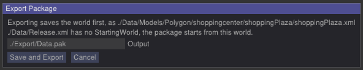

.. _Packaging:

=========
Packaging
=========

The packer turns your game's ``Data`` folder into a single ``Data.pak`` file that you can ship. It works out what the game can reach, converts the models, and writes one package plus a report that says what went in and why.

Why package a game
==================

During development you work with loose files: raw models, textures and worlds in ``./Data``, edited in place. That is the right setup for building a game, and not for releasing it:

* **One file instead of a folder.** A release is a ``Data.pak`` next to the engine, not a loose copy of everything you ever imported.
* **Only what the game uses.** The packer follows the game from its starting world, so test maps, unused models and abandoned textures stay out of the release.
* **Models you can redistribute and load fast.** Raw formats (FBX, OBJ, GLTF) carry redistribution restrictions and are parsed on every load. The package carries :ref:`limonmodel <limonmodel>` files instead, which are quicker to load and use less memory.
* **A check before players find the problem.** The report lists every file that was packed and why, and every file that a world or extension names but that does not exist. A broken texture path shows up in the report instead of in front of a player.
* **You can still patch.** Loose files in ``./Data`` replace the packed file with the same path, so a single asset can be tested against the package without repacking.

If you are still building the game, you do not need the packer. Use loose files, and package when you have something to ship.

What goes into the package
==========================

The packer starts at the **starting world** and follows references from there. Nothing that the game cannot reach is packed.

* **Worlds.** The starting world, and every world that a packed world names, for example in a trigger parameter that loads another map. A world that is only loaded by a path written in code must be declared, see below.
* **Files the worlds name.** Models, textures, sounds, fonts, GUI images, skyboxes, the render pipeline and everything else a world file references.
* **Files that extensions declare.** A trigger, actor or other extension that uses a ``./Data/...`` path written in its own code must declare it, see :ref:`API-pack-file-access-list`. The packer includes the declared files of every extension a packed world uses. A declared folder is packed whole.
* **Scripts.** The Python files of the types that are used, and the modules they import.
* **Files the engine reads by name.** ``Release.xml``, ``Options.xml``, ``inputBindings.xml``, the two default fonts and the crosshair texture, whenever they exist.

Models are not copied. Each model a packed world uses is **converted** to a ``limonmodel`` and stored in the package under the same name. The worlds in the package are rewritten to refer to the converted models and their materials, so the package behaves as if the models had always been ``limonmodel`` files. The files in your ``./Data`` folder are not touched. For which textures of a model are included, see :ref:`AssetManagement`.

The package also carries a manifest, ``Data/pack_manifest.xml``, which tells the engine which converted model replaces which source model.

Files are stored without compression. Most of a game is images and sound that are already compressed, so deflating them buys little.

The report
==========

Next to the package, the packer writes ``<package name>.report.txt``, for example ``Data.pak.report.txt``. It is rewritten on every run. It has these sections:

* **Worlds** - every world that was reached.
* **Types** - every trigger, actor, player extension, camera attachment or render method that was reached. A type is reached when a packed world, or the render pipeline, names it.
* **Converted models** - each source model, the ``limonmodel`` it became, and why it was packed.
* **Files** - every other packed file, with the reason in brackets, for example *referenced by Data/Maps/Town.xml* or *declared by MyTrigger*. A texture lists the models that use it.
* **Problems** - what the packer could not do, see below.
* **Repaired texture paths** - textures that a model named with a wrong path or case, and that were found by file name. The package refers to the right file. The list tells you which models to fix in the source.

Read the **Problems** section before shipping. A problem is a file that something names but that does not exist, or a script module that could not be found. The package is still written, but the game will be missing what the problems name.

Some failures stop the package from being written at all: a world that cannot be read, a model that cannot be loaded or converted, or a file that cannot be added to the archive. The report is still written so you can see why, and no package is left behind. A half written package is never kept where a game would mount it.

Starting world and ``Release.xml``
==================================

``Data/Release.xml`` tells the engine which world to start. It is a small file:

::

    <Release>
        <StartingWorld>./Data/Maps/Town.xml</StartingWorld>
    </Release>

When the engine is started without a world parameter it reads this file and loads that world. The packer uses it the same way: the package is what ``StartingWorld`` reaches. A game with no ``Release.xml``, or one without a ``StartingWorld``, cannot be packed from the command line.

The editor can package from a different world than the one in ``Release.xml``. In that case the package contains a ``Release.xml`` that points to the chosen world, and your own ``Release.xml`` on disk is not changed.

Shipping the package
====================

Put the package next to the engine executable and name it ``Data.pak``. The engine mounts it at startup and prints ``Mounted ./Data.pak`` to the console. A game ships as:

* the engine executable and its libraries
* the ``Engine`` folder
* ``Data.pak``
* your plugin library, if you have one

From then on, ``./Data/...`` paths are read from a loose ``./Data`` folder first, then from ``Data.pak``. If you ship no loose ``Data`` folder, everything comes from the package. If a loose file exists with the same path as a packed one, the loose one wins. That is useful for testing a fix, and a reason not to leave stray files in ``./Data`` on a build you give to testers. ``./Engine`` files are never overridden.

To run a different package without renaming files, start the engine with ``--loadpak``:

::

    LimonEngine --loadpak ./Export/Other.pak

The parameter can sit anywhere among the others, so ``LimonEngine --loadpak Other.pak ./Data/Maps/Town.xml`` also works. The named file is mounted in place of ``./Data.pak``, with the same rules for loose files. The engine stops with a message if the file does not exist. This is handy for trying several builds or games side by side. ``--loadpak`` can not be combined with ``--pack`` or ``--convert``.

A running game that has a package mounted refuses to pack. A package cannot be packed again, since that would hand the assets of one game to anyone who owns the other.

Packing from the editor
=======================

The editor has an **Export Package** button, next to **Save World**. See :ref:`Exporting a package <EditorExportPackage>` for the steps. The editor lets you pick the starting world and the output path, saves your work first, and shows progress while the package is built.

    The export confirmation, with the starting world choice and the output path.

The editor is locked while a package is being built, since anything that could load an asset would compete with the packer.

Packing from the command line
=============================

::

    LimonEngine --pack <source Data directory> <output package>

For example:

::

    LimonEngine --pack ./Data ./Export/Data.pak

Run it from the engine directory. The engine starts as usual, packs, and exits.

* The source directory is read as the game's ``Data`` folder, whatever it is named, with no ``Data.pak`` mounted. It must contain a ``Release.xml`` with a ``StartingWorld``.
* The output folder is created if it does not exist. An existing package with the same name is replaced.
* The report is written next to the output, as ``<output package>.report.txt``.
* The exit code is ``0`` when the package was written, and ``-1`` when the arguments are wrong, the pack was refused, or it failed. The console prints one line per converted model, and a final line with the number of files, converted models, worlds and problems.

The command line is the way to package in an automated build, since it does not need a person to click a button. It always packs what ``Release.xml`` starts from.

Models are converted several at a time. The ``pack_maxModelsInFlight`` option (default 10) caps how many are held in memory at once. Lower it if the packer runs out of memory on a game with very large models.

When the packer refuses
=======================

The packer stops before doing any work, and says why, when:

* a package is already mounted, as above. Move ``Data.pak`` away, or run the editor without it
* a model has unsaved changes in the editor, since worlds are read from disk and the edit would be left out. The editor saves them for you when you export.
* a package is already being built
* the output folder cannot be created
* there is no starting world, from ``Release.xml`` on the command line

.. seealso::

   * :ref:`UsingBuiltinEditor` -exporting from the editor
   * :ref:`AssetManagement` -``limonmodel`` files and which textures are packed
   * :ref:`API-pack-file-access-list` -declaring files from an extension
   * :ref:`API-file-access` -the file layers and the access rules
   * :ref:`GettingStarted` -launching the engine
